## Overview
<!-- layout: hero, title and overview left, browser mockup right -->
PLANETSTEWARDS studies how human activity in space should be governed. The first imagery read as astronomy: planets, no people, no hardware. A reviewer asked where the human interventions were, and the PI flagged that the pictures didn't form a storyline. The redesign had to put human presence in orbit, on the Moon and on Mars at the centre of the visual narrative, while staying credible to academic partners.
## Requirements and process
<!-- layout: requirements list, then palette swatches, then reference images in a row -->
- Credible to institutions, approachable to students.
- White-led, even though space is conventionally shown dark.
- A clear path from landing page to abstract submission and registration.
### Colour palette
<!-- layout: swatch row -->
- Brand Blue #003399: brand and every primary action
- Brand Yellow #F5B23F: event and submission buttons, highlights
- White #FFFFFF: section and page backgrounds
### References
<!-- layout: three images in a row -->
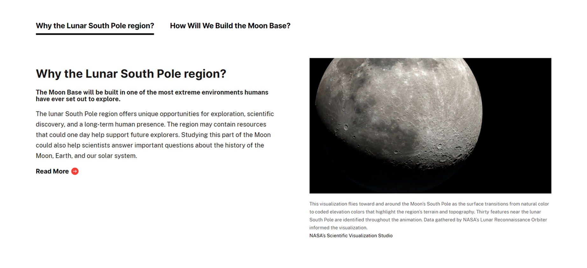
*Reference: NASA, Moon base project. Human presence shown on another body.*
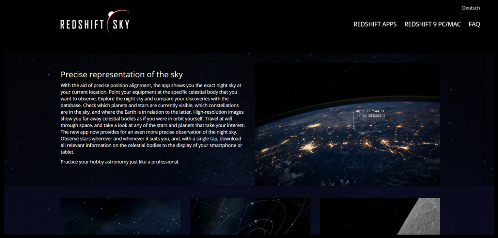
*Reference: Redshift Sky, logo construction.*
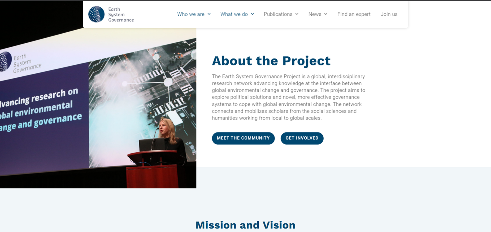
*Reference: Earth System Governance, academic project layout.*
## Information architecture
<!-- layout: initial sitemap diagram left, shipped navigation (rendered as live HTML from the list below) right -->
The first sitemap mirrored the research proposal: Home, The Project, Key Objectives, Methodology and an International Advisory Board. It described the project but gave it nowhere to grow. Once the project started publishing papers and running events, the site had to carry outputs and a calendar, not just a description.
The shipped navigation expanded these pages and added Publications, News and an Annual Events branch. Each year's event becomes a new page under Annual Events, so the menu never has to be restructured.
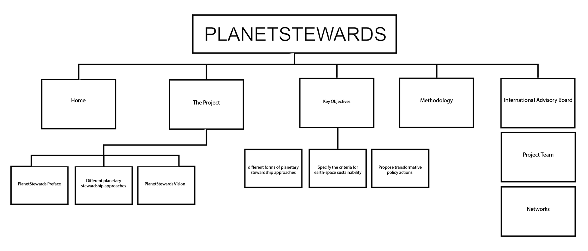
*Initial sitemap, organised around the sections of the research proposal.*
### Shipped navigation
- The Project
- Project Team
- Research
- Publications
- International Assessment Panel on Earth-Space Sustainability (IPESS)
- News
- Annual Events
  - ESS 2024
  - Earth-Space System Workshop 2025
  - ESS 2026
  - Earth-Space Academy 2026
## The Solution
<!-- layout: one headline, body below, desktop view next to body and a row of phones under -->
With September Khu, I shaped the site's visual identity and layout: moodboards and logo concepts, a blue-and-yellow palette with Roboto, and a structure built around the project, team, publications and symposium. I worked on visual hierarchy, image placement and icon styling, and produced the space-debris motion piece.
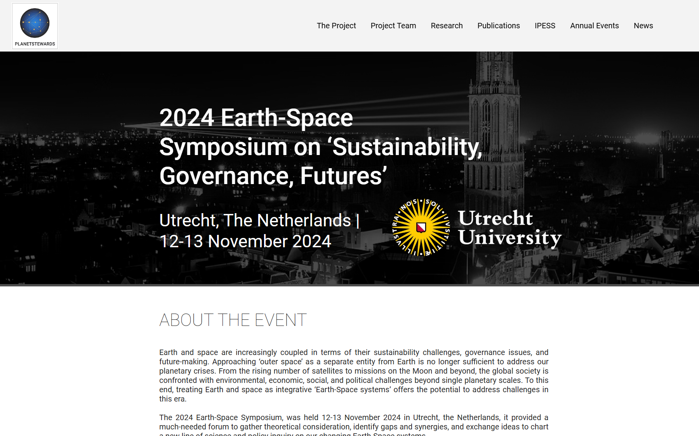
*2024 Earth-Space Symposium event page on desktop.*
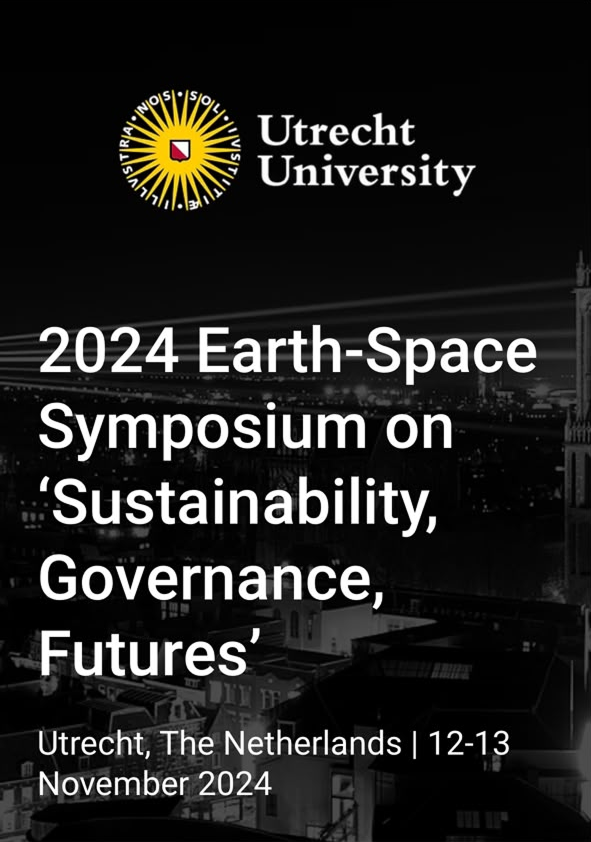
*2024 Earth-Space Symposium.*
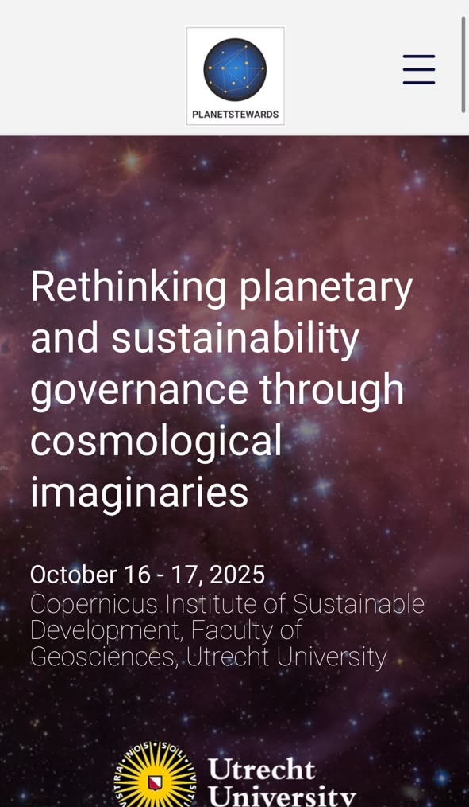
*2025 event page, built from the same template.*
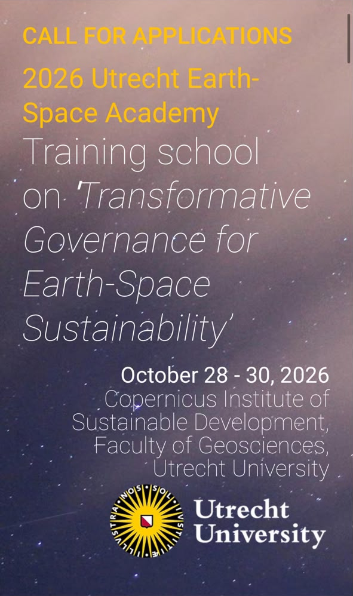
*2026 event page, built from the same template.*
### Call for Papers
<!-- layout: body left, three phones right -->
The symposium needed a route from first visit to submitted abstract. The menu highlights the current event, the event page leads to the Call for Papers, and the abstract form follows the layout the PI asked for, with the button relabelled from APPLY to SUBMIT.
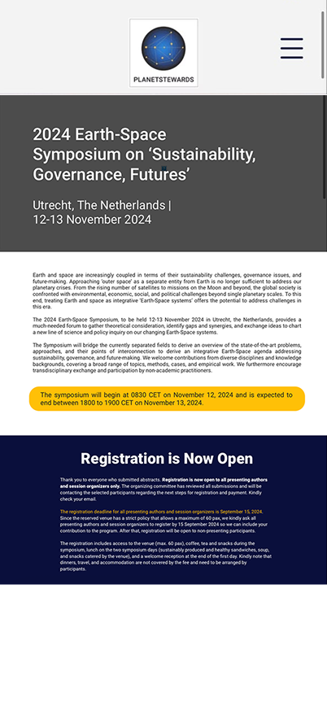
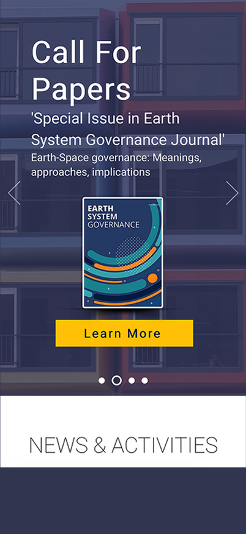
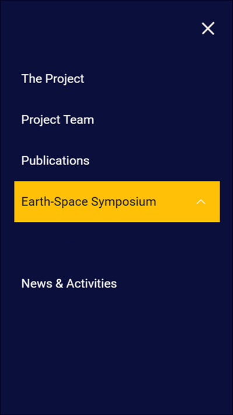
*From left: abstract form, Call for Papers, mobile menu. 2024 pages captured from the Wayback Machine.*
## Feedback and iteration
<!-- layout: table, then logo revisions row, then Earth-Moon-Mars sequence -->
| Feedback | Source | Response |
|---|---|---|
| Logo "very busy"; fewer globe grid lines, or replace the grid with constellation lines and dots. | External reviewer, via the Principal Investigator | Removed the globe grid and kept the constellation lines and dots, the reviewer's second option. |
| "Where are the human interventions?" | External reviewer | Produced a space-debris motion piece for the homepage. |
| Placement of the Moon and Mars on the homepage. | Principal Investigator, several rounds | Kept the Earth, Moon, Mars sequence, each paired with a strip of human activity there. |
| Secondary images too large; return to a strip. | Principal Investigator | Cropped them into a 525px strip and applied parallax motion. |
| Abstract submission form "like the contact form of earth-space.today". | Principal Investigator | Built the Call for Abstracts form and relabelled the button from APPLY to SUBMIT. |
### Logo revisions
<!-- layout: three logos in a row, same size -->
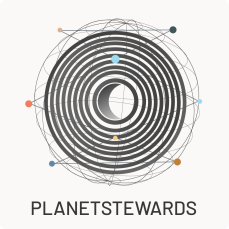
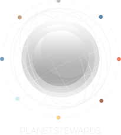
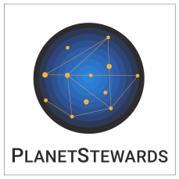
*From left: v1, v2, final.*
### Earth, Moon, Mars sequence
<!-- layout: vertical stack of homepage sections, labelled Earth / Moon / Mars -->
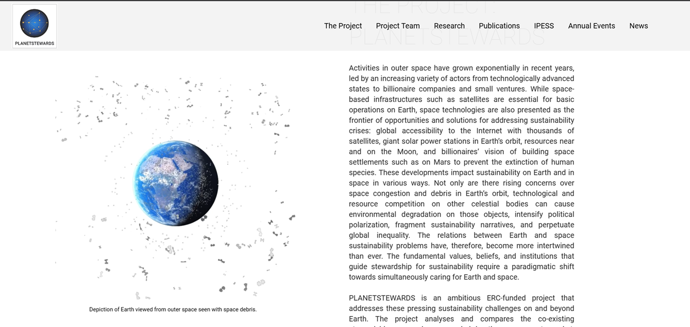
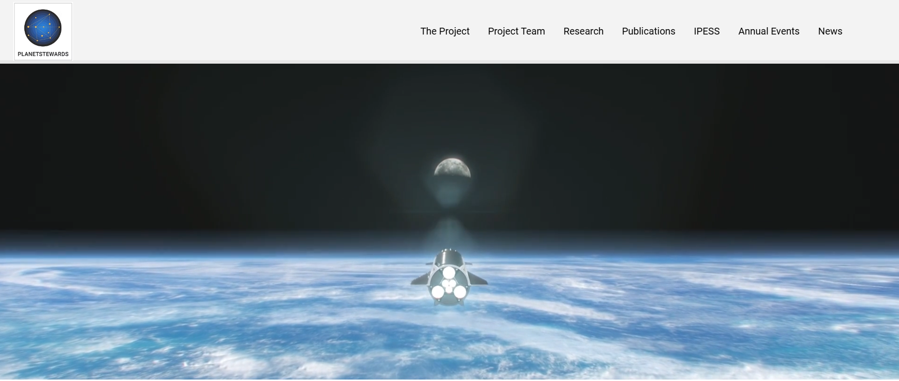
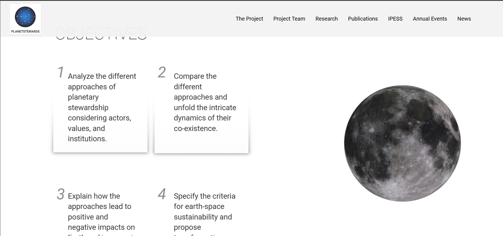
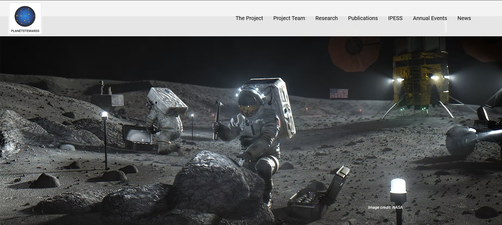
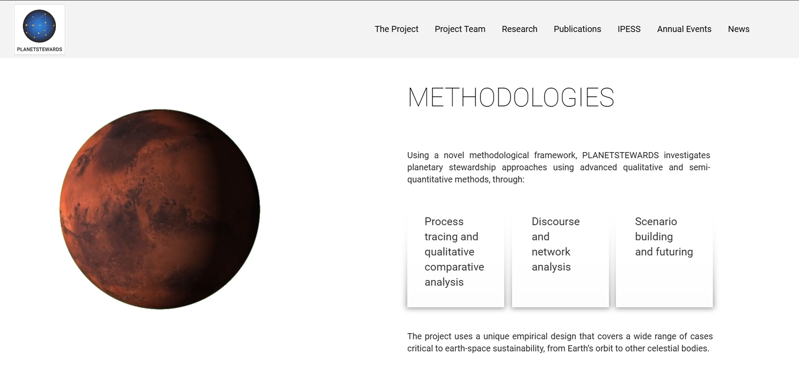
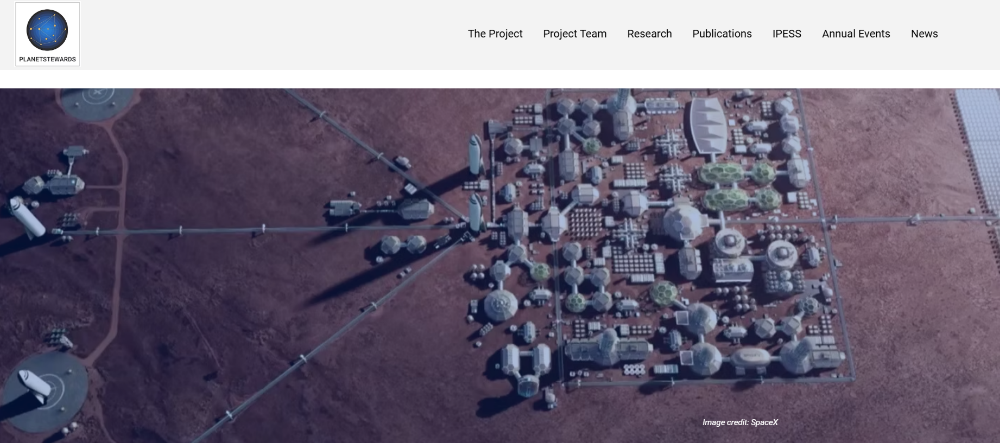
*Each homepage section pairs a planetary body with a strip of human activity there: Earth, then the Moon, then Mars.*
### Space debris motion piece
<!-- layout: full-width video, body below -->
<!-- video: ./videos/space-debris-motion-piece-01-homepage.mp4 | autoplay, muted, loop, playsinline, show a still frame when reduced motion is on | alt: Earth seen from space, ringed by drifting debris -->
A reviewer asked where the human activity was. The imagery showed planets, not what people have put around them. I produced a short loop of Earth surrounded by orbital debris. The footage was sourced from Freepik and composited and animated in CapCut. It is illustrative, not data-driven. Used on the homepage.
## Built to be maintained by researchers
<!-- layout: two columns; left: copy then publications screenshot; right: news screenshots -->
I designed three content templates: publication entry, news entry and event page. The research team has since published 25 news entries and three more events on them without design support. The site has run from 2024 to 2026.
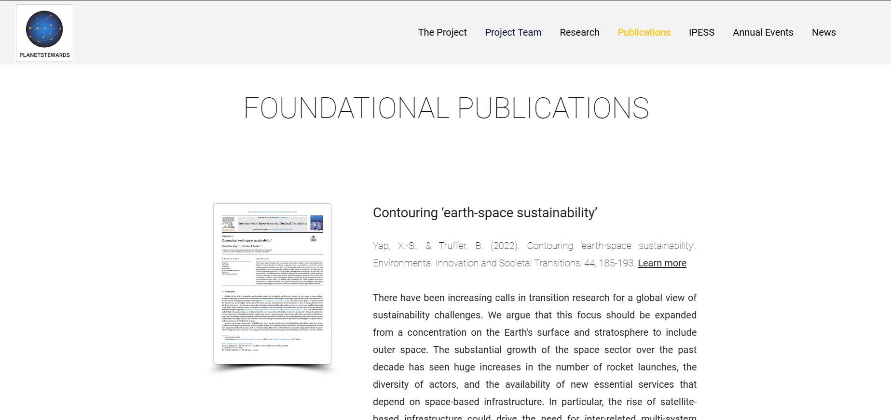
*Publication entries.*
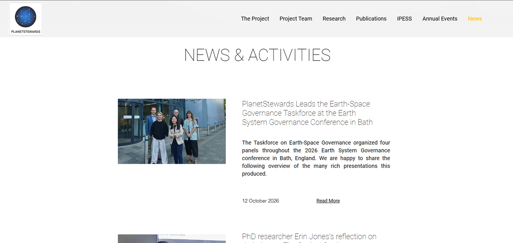
*News entries.*
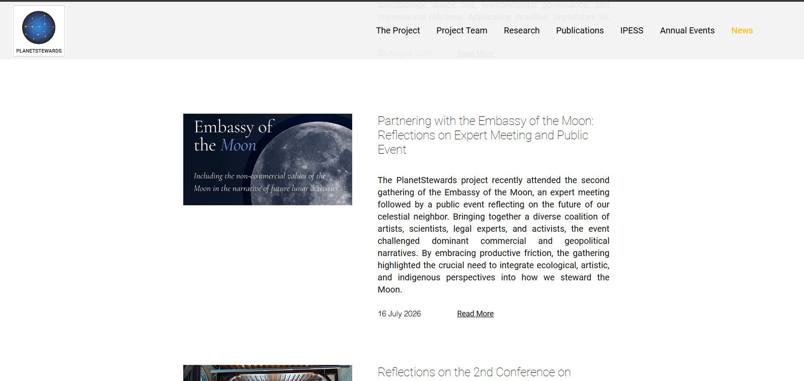
*Page entry.*
## Results
<!-- layout: stat cards, first card largest -->
Jun 2024 – Jun 2025 · Wix Analytics
- **6m 2s** average session length
- **1,679** unique visitors across 3,295 sessions
- **61%** of sessions from outside the Netherlands
- **265** sessions referred from uu.nl, and **265** from LinkedIn (200 referral, 65 organic)
### Earth-Space Symposium
<!-- layout: body, then three photos in a row -->
The first Earth-Space Symposium brought 60 scholars, policymakers, artists and practitioners from 21 countries to Utrecht University, filling the venue. I produced the symposium landing page, Call for Papers and registration pages.
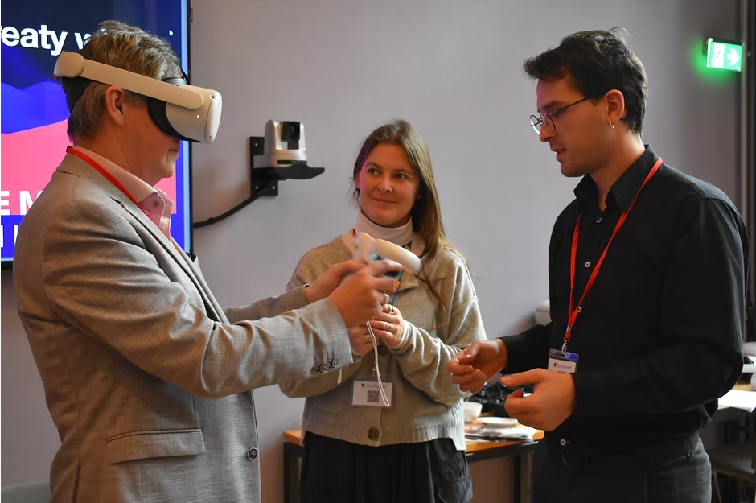
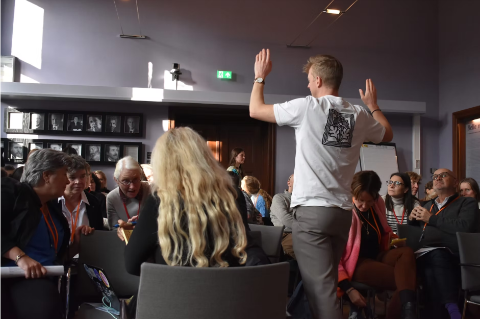
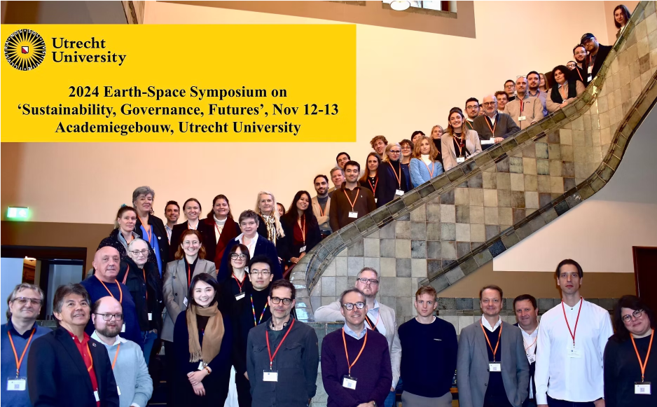
*Photos: Ori Morales Hernández, PLANETSTEWARDS Project.*
## Reflection
Every decision had to pass two tests: credible to a professor, inviting to a student. The PI asked for the 2024 Symposium as a top-level menu item with Call for Abstracts beneath it. I built it as requested. Once the programme added a workshop, an academy and a second conference, that slot had to become an Annual Events menu. I should have proposed a structure built for a recurring series when I implemented the request, not just the single event in front of us. Next time I would also test the submission flow with researchers before launch, and set mobile body text left-aligned.