## Overview
<!-- layout: hero, title and overview left, browser mockup right -->
Precious Wedding's website worked, but its fair landing pages didn't carry the weight of a bridal decision. Each in-house fair needed a page that felt personal and romantic, and that still led every visitor to one next step: an RSVP or a WhatsApp enquiry.
## Requirements and process
<!-- layout: requirements list, then palette swatches, then reference and wireframe side by side -->
- Each in-house fair needed its own landing page, produced again for every fair without starting over.
- The page had to feel romantic enough for a bridal decision.
- Every visitor had to reach one action: RSVP for the fair, or message the sales team in a way they could trace back to the website.
### Colour palette
<!-- layout: swatch row -->
- Crimson Red #911421: event hero, primary CTA
- Light Greyish Beige #E6E0DD: section backgrounds
- Rose Taupe #856F74: mobile menu
- White #FFFFFF: section and page backgrounds
### Typography
- Cormorant Garamond Display: Heading
- Futura: Body text
### References and wireframes
<!-- layout: two images in a row -->
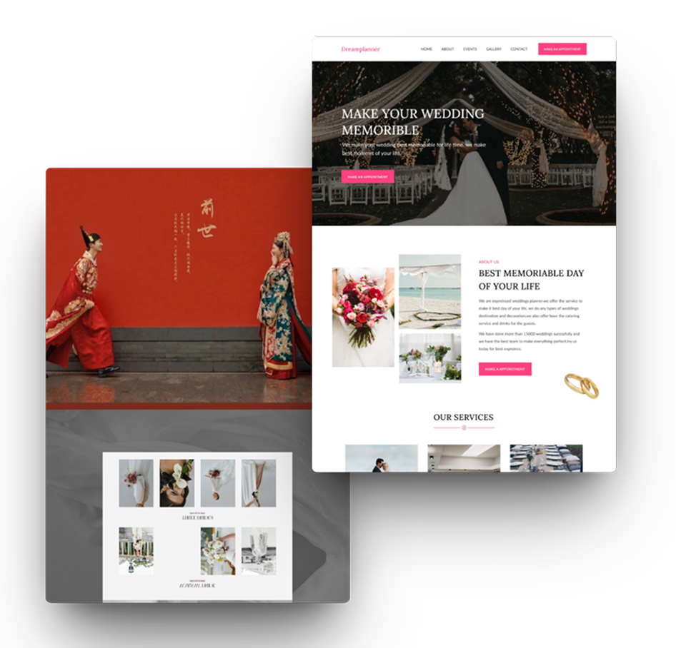
*Reference: Pinterest layouts of bridal websites and classic Chinese-themed weddings.*
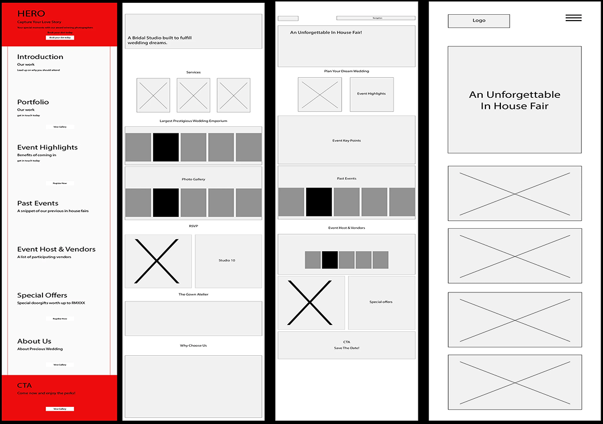
*Wireframe of the section kit: hero, services, reviews, photo grid, CTA.*
## The Solution
<!-- layout: one headline, body below, desktop view next to body and a row of phones under -->
Each fair used to start from scratch. On Wix, I built a reusable kit: Cormorant Garamond for display, Futura for body text, a beige and taupe palette with crimson reserved for the main CTA. Pages were assembled from fixed sections (hero, services, reviews, photo grid, CTA) and re-skinned per campaign, so a new fair page meant swapping imagery, dates and offers, not redesigning. Every page was designed for desktop and mobile and shipped with titles, meta descriptions and keywords set for search.
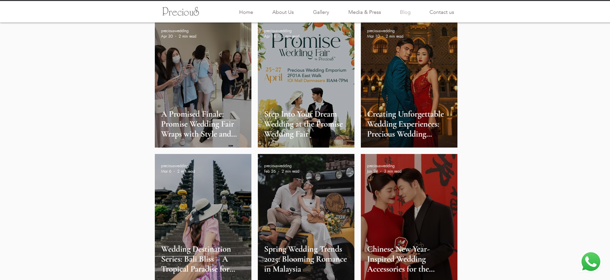
*Event highlights on desktop.*
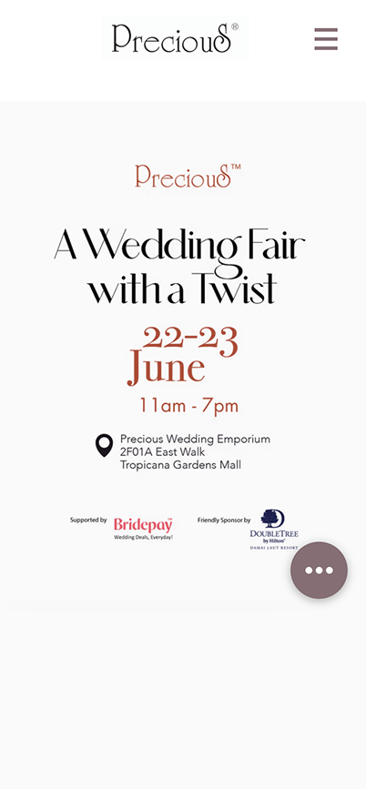
*June 2024: A Wedding Fair with a Twist.*
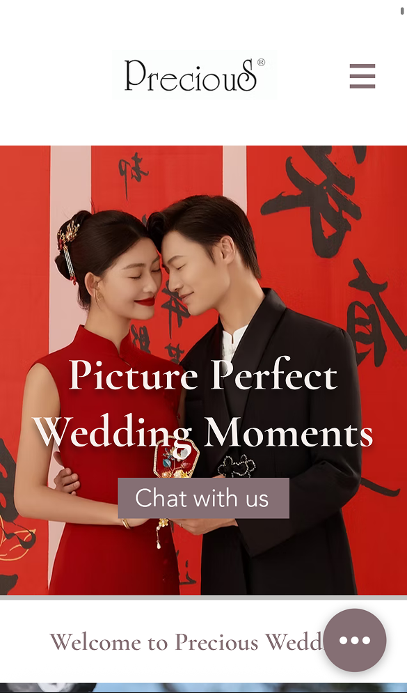
*January 2025: Picture Perfect Wedding Moments.*
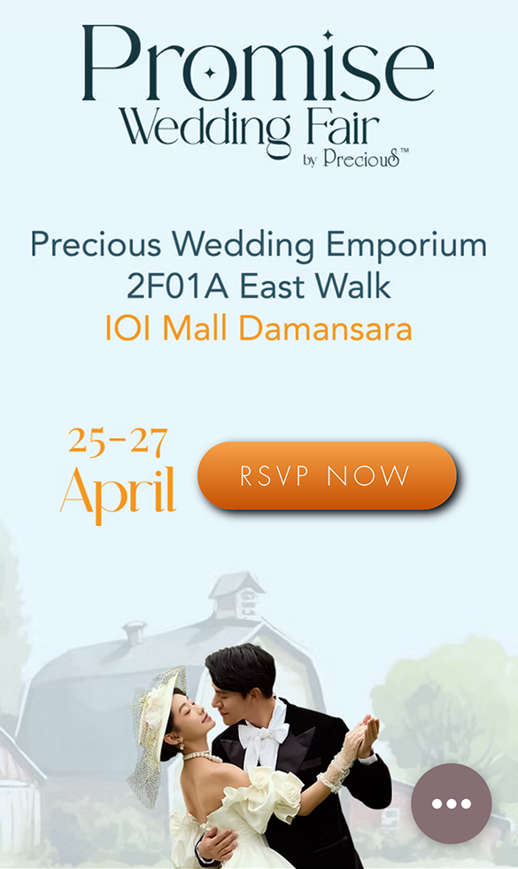
*October 2024: Precious Wedding Fair 3.0.*
## Feedback and iteration
<!-- layout: table, then two phones in a row -->
| Feedback | Source | Response |
|---|---|---|
| Every fair starts from a blank page; nothing carries over between campaigns. | Marketing Manager | Built a section kit (hero, services, reviews, photo grid, CTA). Each fair page was the same kit re-skinned with new imagery, dates and offers. |
| "We want customers to engage with us directly so we know they came from the website." | Marketing Manager, several rounds | Replaced the generic contact link with a Chat with us WhatsApp button that opens a pre-filled message naming where the visitor came from. |
| Most landing-page visitors click RSVP, not the WhatsApp button (25 RSVP clicks at the mid-campaign check). | Cloud Media (ad agency), June 2024 | Made Chat with us the primary CTA and reduced the number of RSVP buttons on the page. An RSVP click gave a name on a form; a WhatsApp enquiry gave sales a conversation, which is what the business asked for. |
| Make the January landing page more festive; lead with Chinese-costume photos. | Marketing Manager, Jan 2025 | Rebuilt the January hero around modern Chinese-costume photography ("Picture Perfect Wedding Moments"). |
| Blog: Recent Posts sit at the bottom, and the event posts are out of date. | Marketing Manager, Jan 2025 | Redesigned the blog layout and turned each fair into an event-highlights post with SEO titles and meta descriptions, maintained June 2024 – May 2025. |
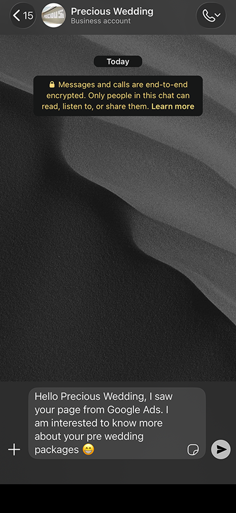
*Chat with us, pre-filled WhatsApp.*
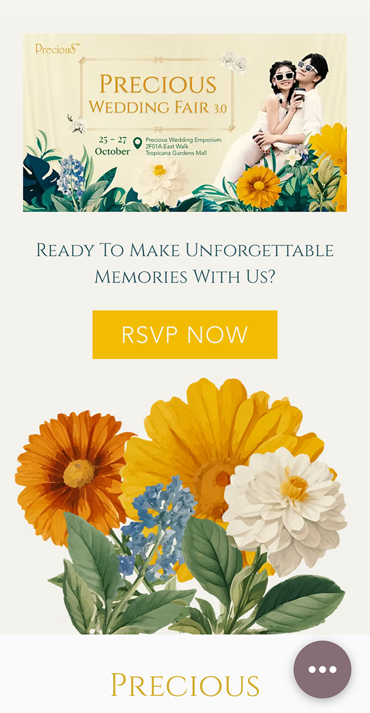
*Event-highlights post: A Wedding Fair with a Twist.*
## RSVP flow
<!-- layout: three phones in a row with numbered step labels and arrows, body under -->
Visitors preferred the RSVP button, but a form click told sales nothing. I made Chat with us the main route, so every lead started as a conversation the team could trace to the website, and the RSVP form followed inside that chat.
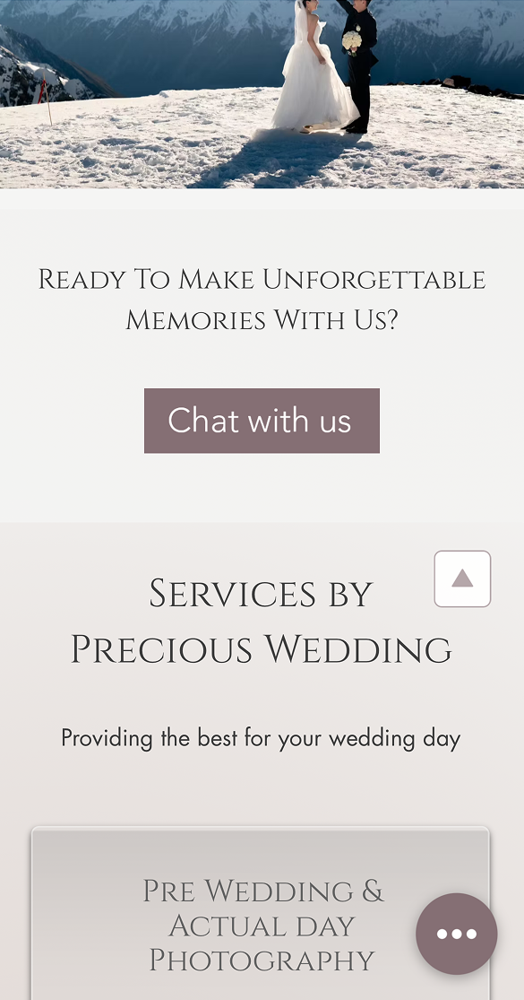
*1. Chat with us.*

*2. WhatsApp, pre-filled: "I saw your page from Google Ads…"*
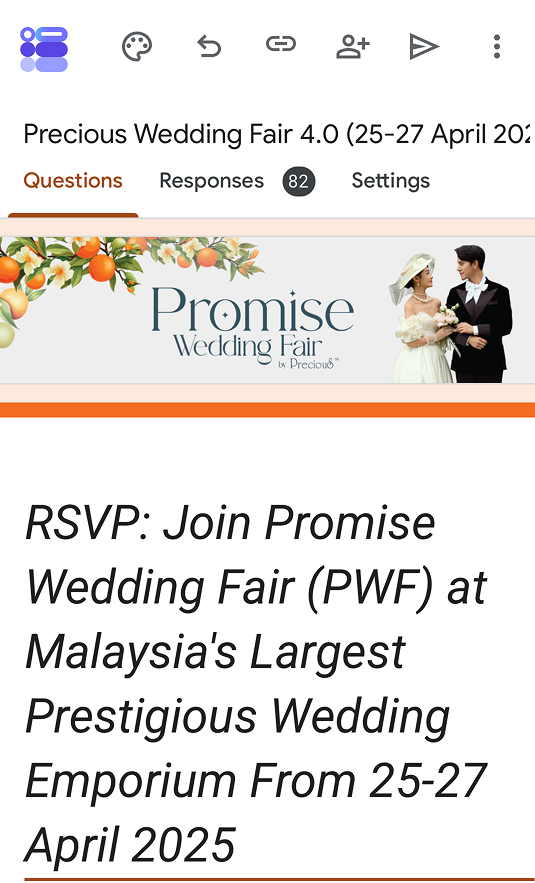
*3. RSVP form sent by sales. Editor view: 82 responses, Precious Wedding Fair 4.0, April 2025.*
## In-house wedding fair
<!-- layout: body, then three photos in a row -->
The fairs brought couples to Precious Wedding Emporium at IOI Mall Damansara (formerly Tropicana Gardens Mall) for gown trials, gown-rental promotions and offers. For each fair I designed the landing page and the RSVP flow, along with the print and screen campaign. The April 2025 Precious Wedding Fair 4.0 (25–27 April) promoted a lucky draw, a first look, destination weddings and an all-in-one-place offer.
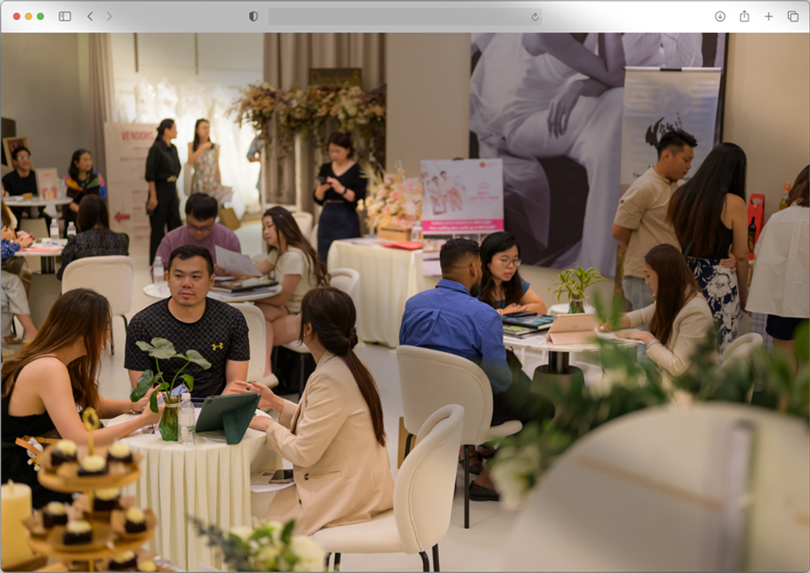
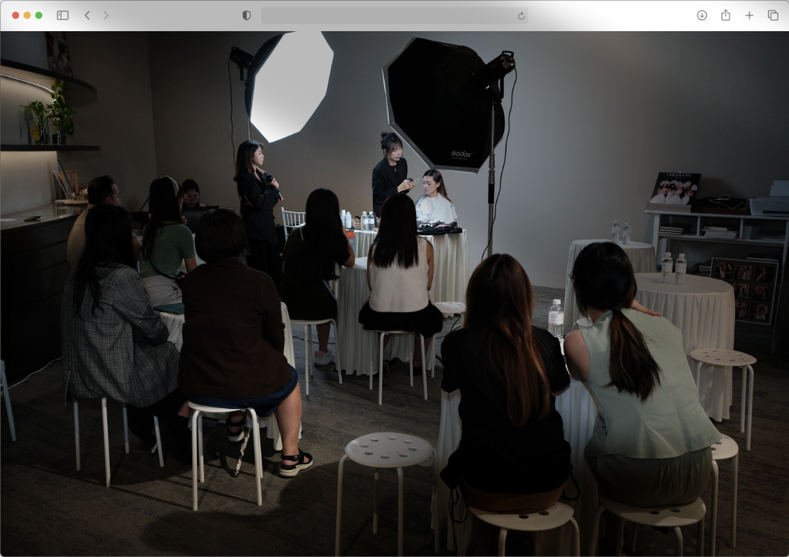
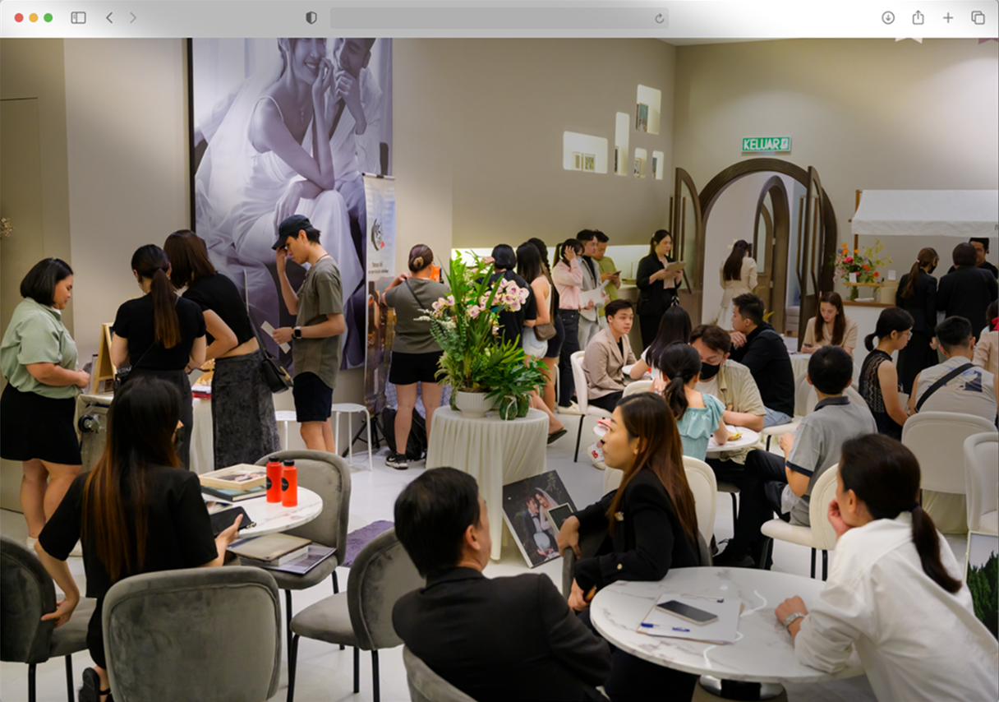
*Photos: Zach Photography Team, Precious Wedding.*
## Results
<!-- layout: stat cards, RSVP card first -->
June 2024 - July 2025 · Wix Analytics; RSVP from Google Forms
- **82** RSVP form responses, Precious Wedding Fair 4.0, April 2025
- **55,728** site sessions
- **68%** of March 2025 sessions included the fair landing page (2,578 of 3,793)
- **86%** of sessions on mobile
### What changed for the business
- **One kit, many campaigns.** The same section kit carried the June 2024, October 2024 and April 2025 fairs, the January 2025 festive page and the Destination Weddings campaign. Each new page was a content swap, not a redesign.
- **Emotion with clarity.** Editorial serif type and full-bleed couple photography carry the romance. One primary CTA per screen carries the action.
- **Conversations, not clicks.** Leads arrived on WhatsApp already tagged as coming from the website, and the April 2025 RSVP form collected 82 responses.
## Reflection
Landing pages work when emotion and clarity share the same screen. The agency's data showed visitors preferred clicking RSVP, but the business needed conversations, so I made WhatsApp the main route and moved RSVP inside the chat. I never measured whether that raised enquiries, because WhatsApp leads weren't counted against page visits. Next time I would tag both CTAs with click events before launch, so the trade-off between an easy click and a real conversation shows up in numbers.