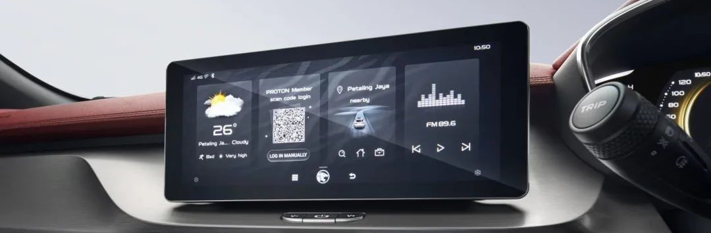
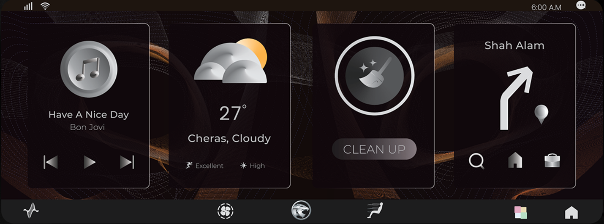
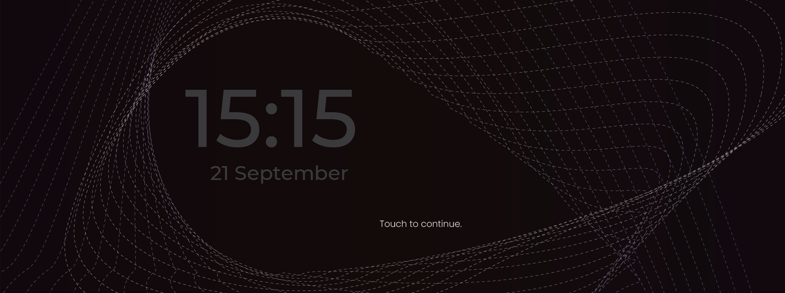
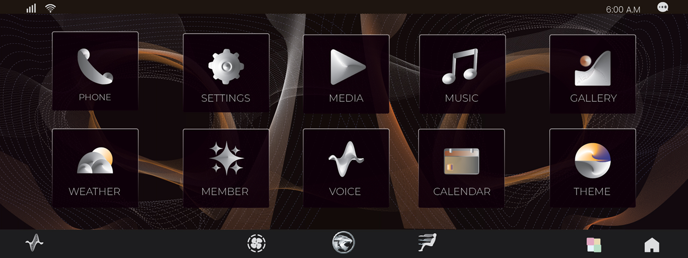
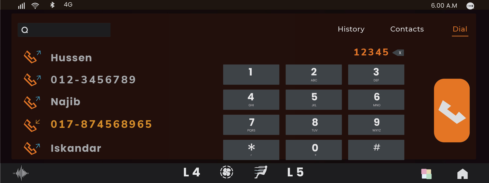
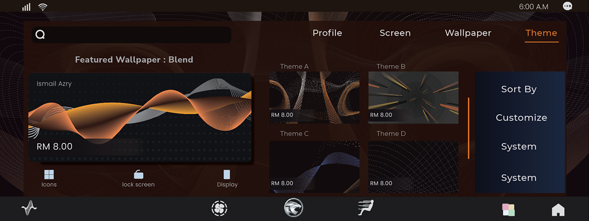
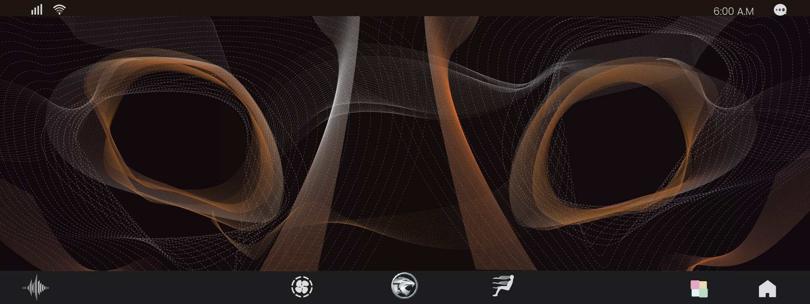
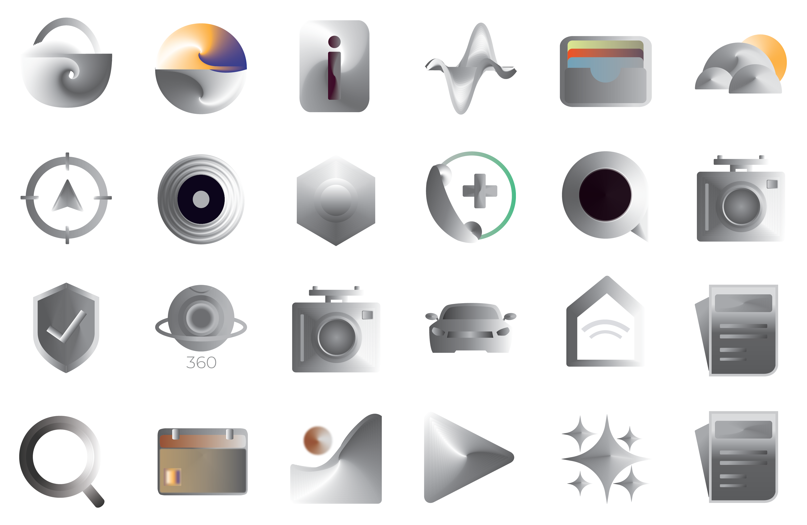
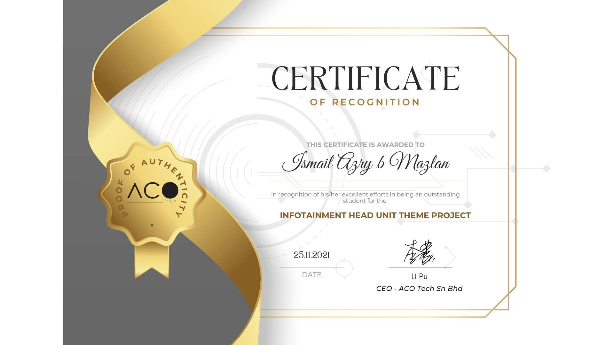

## Overview
<!-- layout: hero, title and overview left, head-unit screen right -->
<!-- project label: Industry brief, Multimedia University × ACO Tech. Result: Best Theme -->
ACO Tech, the joint venture behind Proton's infotainment systems, asked MMU students for a new theme for the X50, Iriz and Persona head units. Drivers aged 18–40 were calling the stock theme dull and outdated. I designed a full theme solo: wallpaper, widget homepage, app list, dialer, theme store, lock screen and a 24-icon set, all inside ACO Tech's fixed status bar, climate bar and icon specs. ACO Tech awarded it Best Theme. Screens are shown as submitted in 2021.
## Before and after
<!-- layout: two screens stacked at the same width, labelled -->

*Same screen, same four-card homepage. Flat icons on a zebra-textured grey became chrome objects on a copper-and-silver field. Stock image: ACO Tech.*
The stock homepage runs Weather, Member QR, Nav and Radio. Mine runs Music, Weather, Clean Up and  Nav Login is a one-time action and doesn't earn permanent homepage space.
## The brief
<!-- layout: three short text blocks in a row: The ask, The rules, The move -->
### The ask
Proton drivers aged 18 to 40 were calling the stock head-unit theme dull and outdated. ACO Tech, the company behind Proton's infotainment, opened the problem to MMU students.
### The rules
Every entry had to work inside the live system. The status-bar text stays white, so nothing light. Two fixed bars cover the top and bottom of the screen. Icons have a set size and grid, and partner logos like JOOX can't be touched. Entries were judged on usability, not looks alone.
### The move
I changed the material, not the layout. The homepage keeps its four cards and the app list keeps its grid, so the theme drops into the existing system without new engineering. Everything else became one idea: a tiger's unmissable colour traits that read as premium on a dark dashboard. ACO Tech named it Best Theme from 12 entries.
## Lock screen
<!-- layout: full-width screen, copy below -->

*Quiet until touched.*
The lock screen carries the theme's wireframe at low intensity and shows only the time, the date and one prompt. Tap anywhere to open the home screen, matching the system's existing unlock behaviour.
## App list
<!-- layout: full-width screen, copy below -->

*Every app, one screen.*
The app list puts every app in two rows on a single screen, so the driver never swipes while moving. Labels sit under each icon on a dark backplane, and the climate bar stays clear at the bottom, as the brief required.
## Dialer
<!-- layout: full-width screen, copy below -->

*Built for a glance, not a stare.*
Recent calls on the left, keypad on the right, and one copper call button on the edge nearest the driver in a right-hand-drive Proton. Copper marks only the active tab, the typed number and the call action.
## Theme store
<!-- layout: full-width screen, copy below -->

*Making the theme itself the product.*
The Theme app the brief asked for became a store: Profile, Screen, Wallpaper and Theme tabs, a featured card for the hero wallpaper, and shortcuts to apply a theme to icons, the lock screen or the whole display. Prices are illustrative.
## Wallpaper
<!-- layout: full-width screen, copy below -->

*Dark by rule, warm by choice.*
The brief fixed the status-bar text as white, so the wallpaper had to stay dark. Copper and silver strands carry the colour instead. Each one is placed in the middle band of the screen, because the 40 px status bar and the 80 px climate bar cover the top and bottom.
## Icon set
<!-- layout: icon grid on the dark display, each icon on its backplane -->

*24 icons, one material, inside a fixed grid.*
Every icon shares a brushed-chrome finish and a single light source, drawn to ACO Tech's 100×100 and 80×80 px sizes on a 242×222 px backplane. Colour appears only where it carries meaning: weather, wallet, calendar and the call ring.
## Best Theme
<!-- layout: certificate image left, copy right -->

*Best Theme, chosen by the client.*
ACO Tech awarded the theme Best Theme, the top prize in the 2021 ATLAS brief, with a certificate signed by CEO Li Pu.
## Reflection
The brief judged entries on four usability heuristics, and I designed to the aesthetic one first. Looking back at the submission, the gaps are in the details a driver depends on: the lock-screen clock is too dim, the navigation card shows a turn with no distance or road name, "Cleanup" and the weather values have no labels, and the clock format and climate bar change between screens. If I did it again, I'd test the screens in daylight and audit every label against the brief's app list before choosing colours, because a car screen is read at arm's length in full sun.
