## Overview
<!-- layout: hero, title and overview left, browser mockup right -->
The first bridal fashion week in Malaysia, hosted by The Gown Atelier at Astana Hall, 25–27 July 2025. I designed and built the event website on Wix in two months: the schedule, registration flow, FAQ, sponsor wall and 23 designer pages, plus the email and social assets that drove guests to register.
## One identity across every touchpoint
<!-- layout: four images in a grid -->
The MBFW wordmark, black-and-tan palette and smoke texture carried from the website to the Linktree, the registration cards and the 2026 sign-up page, so a guest arriving from Instagram, Xiaohongshu or email saw the same event.
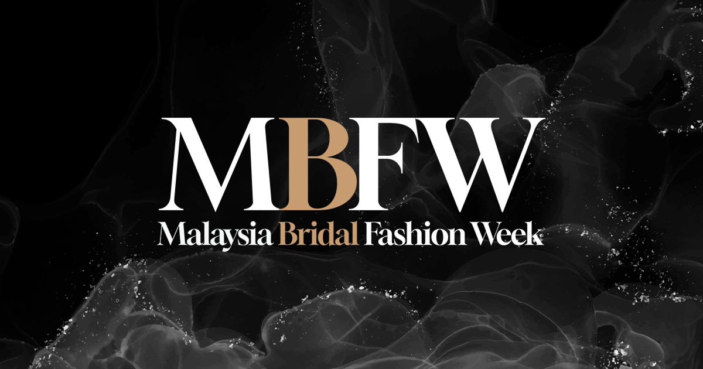
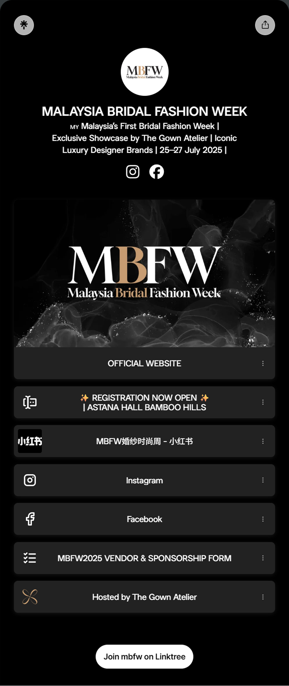
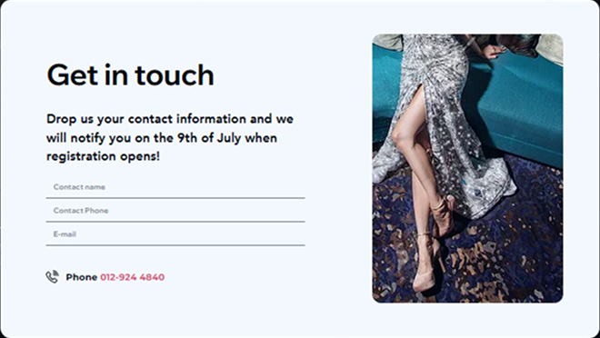
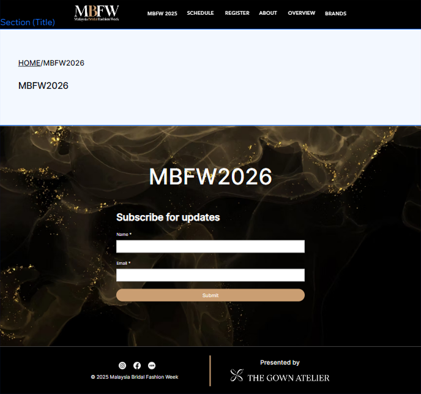
*Social share image, Linktree, and the registration card before and after launch.*
The first registration card was a pre-launch "notify me" form. Once registration opened, it became a single RSVP button with a phone fallback, so the card asked for one action instead of three fields.
## Wireframes and visual system
<!-- layout: wireframes left, palette and type right -->
Early wireframes set the homepage order: event dates first, then four entry points (Schedule, Events, Register, Sponsors), then the brand roll-call. Sponsors and awards got their own page so partner logos never competed with registration.
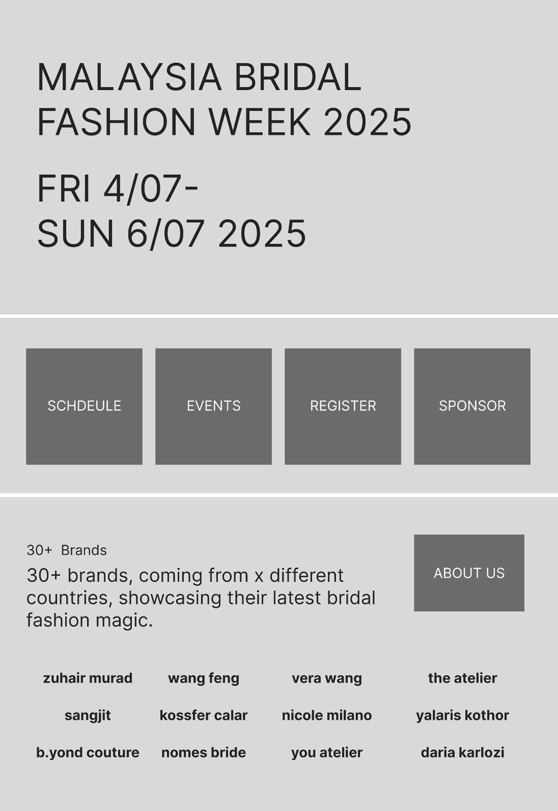
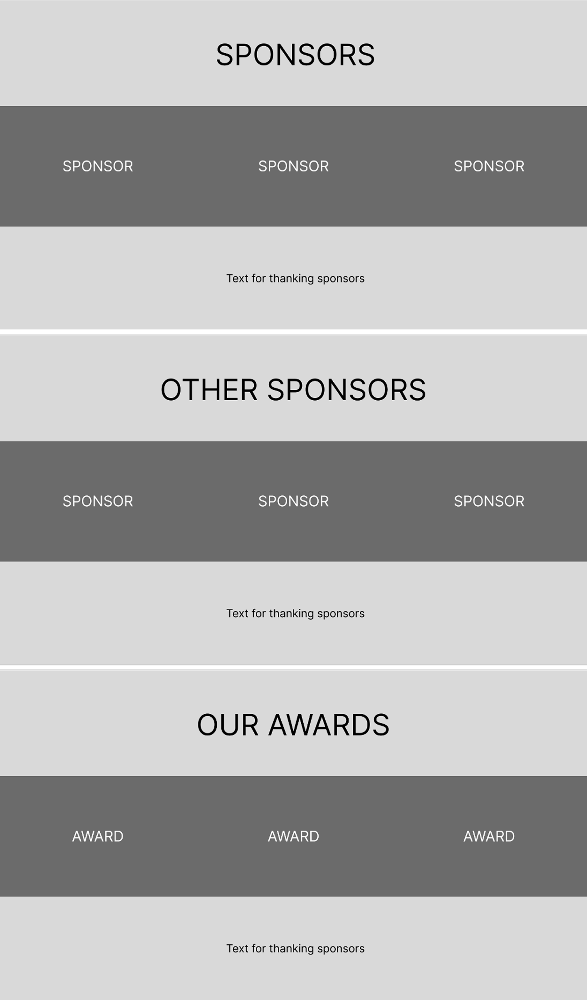
*Early wireframes, 4–6 July 2025.*
### Colour palette
<!-- layout: swatch row -->
Black for an evening runway, tan for every action, white for reading. One accent colour meant the RSVP button was always the brightest thing on screen.
- Runway Black #070707: page backgrounds
- Tan #CA9E72: every button and link
- White #FFFFFF: body text and reading surfaces
### Typography
- Playfair Display: headings and wordmark
- Inter: body text
## Answering the questions before they're asked
<!-- layout: three phones in a row -->
Dates, hours and last entry sit in the first screen on mobile. The FAQ answers five questions: what MBFW is, when and where, who can attend, whether there's a fee, and how to register.
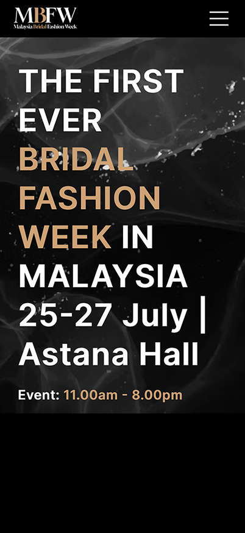
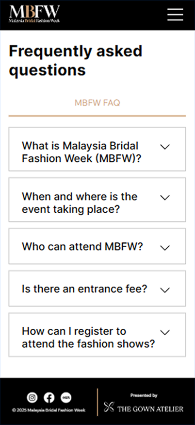
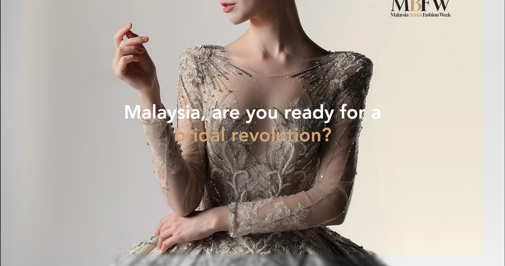
*Mobile hero, FAQ and landing image.*
## Registration that matched capacity
<!-- layout: FULL banner largest, schedule card and menu beside it -->
The schedule card listed day one's programme hour by hour. When opening-day seats filled, the banner switched to "25 July: Full. 26–27 July: Walk-ins open", so late visitors were redirected rather than turned away.
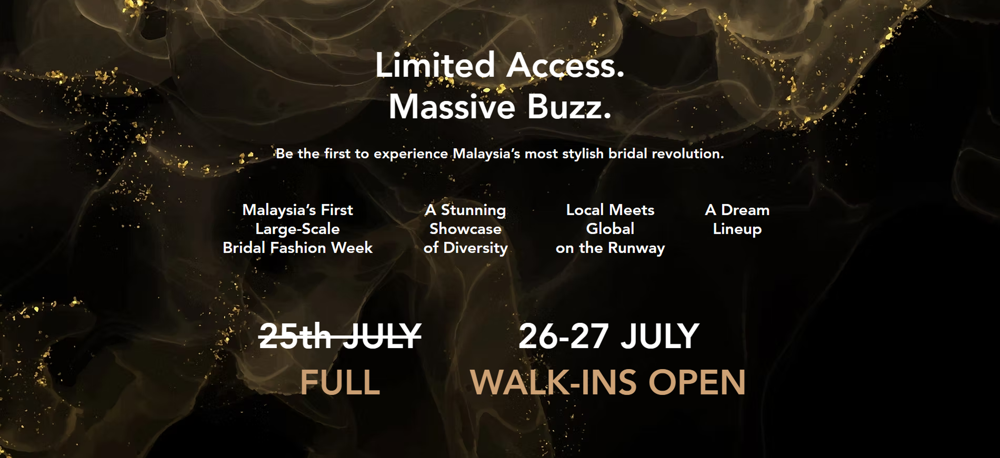
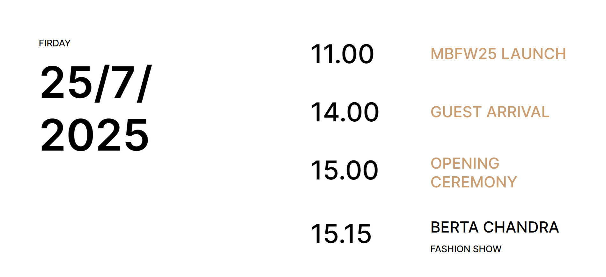
*Day one sold out; the banner sent late visitors to the walk-in days.*
## 23 designer pages, one template
<!-- layout: brand page grid, then search result screenshot -->
Each designer got a page from the same template (name, collection imagery, profile), so adding a brand during the run-up was a content task rather than a design task. The site ranked first on Google for "bridal fashion week" in Malaysia (checked September 2026).
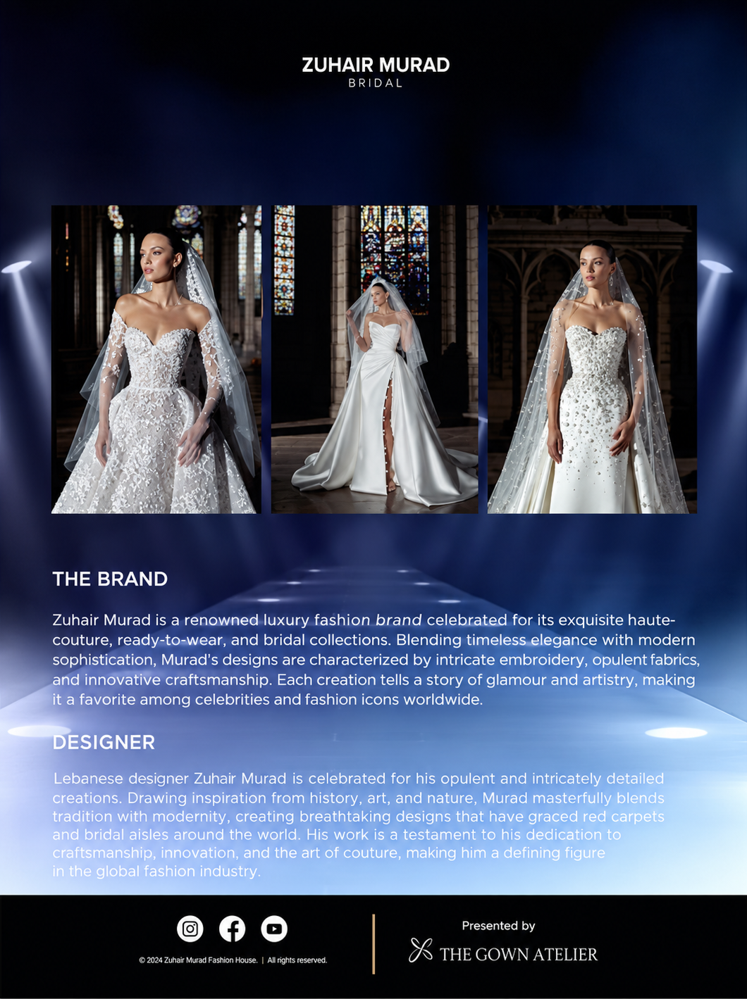
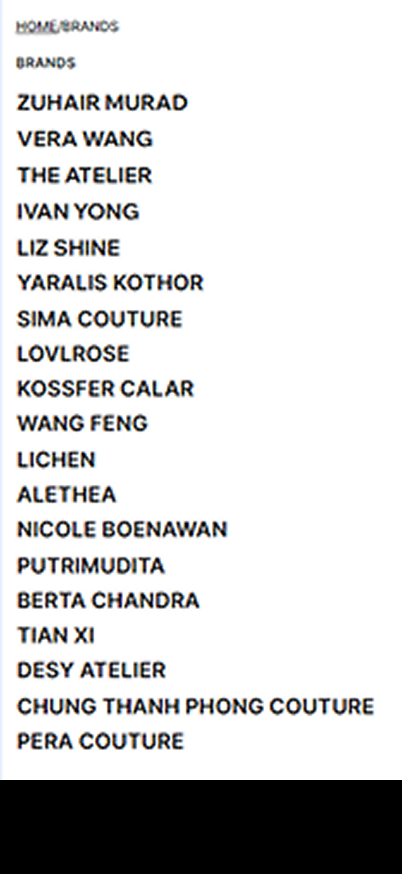
*The invited brands list and one designer page.*
## Built to be reused: MBFW 2.0
<!-- layout: two images side by side -->
For the 2026 edition the site was restructured into MBFW 1.0 and 2.0 sections. The design system, About copy and visual language carried over unchanged, and the 2025 photography became the "Moments of MBFW 1.0" gallery.
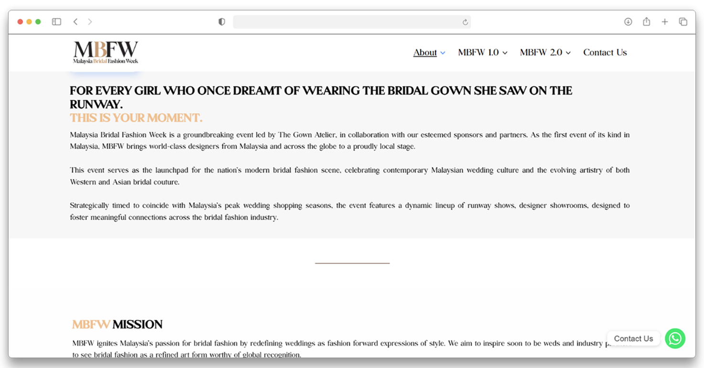
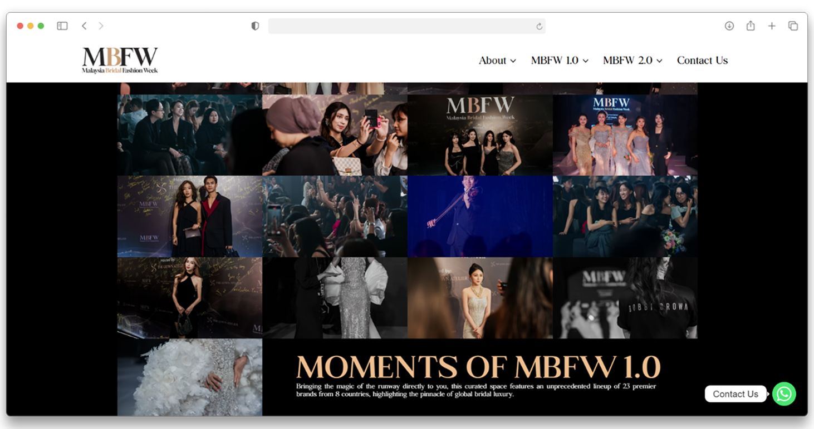
*The 2026 site reused the 2025 system unchanged.*
## Reaching brides where they already shop
<!-- layout: full email on the left, copy right -->
An email campaign sent through Bridepay, Malaysia's largest online wedding marketplace, to put MBFW in front of couples already planning a wedding. I designed the email in the website's palette, with one repeated action, Reserve Your Seat, linking to the same registration flow.
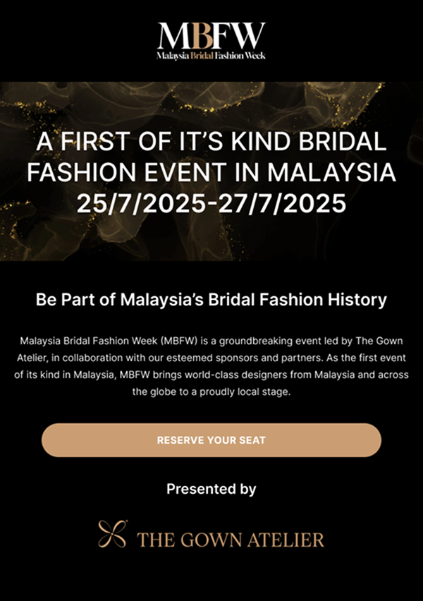
*Bridepay email campaign.*
## Reflection
Two months was enough to launch, not enough to instrument. Registrations ran through a Google Form shared across the website, Linktree and social, so I can't separate how many guests came from the site itself. Next time I would give each channel its own form link or UTM tag before launch, so the website's share of the guests is a number, not a guess.